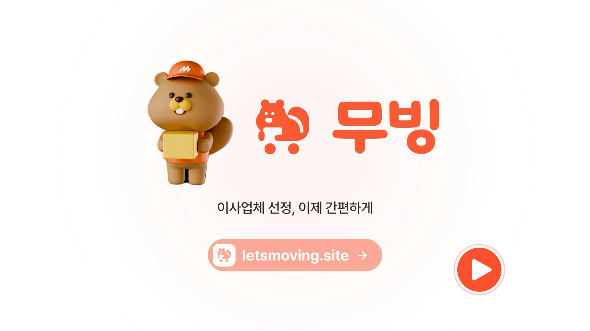

<div align="center">

<a href="docs/banner.png"></a>

# 무빙 (MOVING)

### 견적은 받고, 비교하고, 믿을 수 있는 이사 전문가를 고르세요

[**🌐 서비스 바로가기**](https://www.letsmoving.site) · [**🎬 시연 영상**](시연영상_링크) · [**⚙️ Backend 저장소**](https://github.com/3unbum/13-4-MOVING_BE)

코드잇 스프린트 13기 · 파트4 고급 프로젝트 · 4팀

</div>

<br />

## 📑 목차

1. [프로젝트 소개](#-프로젝트-소개)
2. [기능 구현 영상 · 시연 계정](#-기능-구현-영상--시연-계정)
3. [주요 기능](#-주요-기능)
4. [팀 소개 · 주요 링크](#-팀-소개--주요-링크)
5. [시스템 아키텍처](#-시스템-아키텍처)
6. [기술 스택 · 프로젝트 구조](#-기술-스택--프로젝트-구조)
7. [보안 · 접근성](#-보안--접근성)
8. [트러블 슈팅](#-트러블-슈팅)
9. [직접 실행해 보기](#-직접-실행해-보기)

<br />

## 💡 프로젝트 소개

**무빙**은 이사 소비자와 이사 전문가(기사님)를 이어 주는 견적 매칭 서비스입니다. 소비자가 이사 정보를 한 번 입력하면 기사님들이 견적을 보내고, 소비자는 견적가와 후기를 비교해 고른 뒤 결제와 후기 작성까지 한 서비스 안에서 마칩니다.

이 저장소는 그 **프론트엔드**입니다. 구현하면서 특히 신경 쓴 부분은 이렇습니다.

- **역할(role) 기반 접근 제어** — 일반 유저와 기사님의 화면 · 권한이 다르다는 전제로 라우트 그룹과 가드를 설계했습니다.
- **서버 상태와 화면 상태의 분리** — API 데이터는 TanStack Query가, 입력 폼은 React Hook Form + Zod가 맡습니다.
- **실시간 · 결제 · AI 같은 외부 연동** — SSE 알림, 토스페이먼츠 결제, Gemini 기반 추천을 서비스 흐름에 붙였습니다.
- **4개 국어와 PWA** — URL 단위 다국어와 설치 가능한 웹앱까지 지원합니다.

| 일반 유저                                  | 기사님                                                  |
| :----------------------------------------- | :------------------------------------------------------ |
| 견적 요청 → 견적 비교 · 확정 → 결제 → 후기 | 요청 확인 → 견적 발송 또는 반려 → 확정 알림 → 후기 확인 |

<!-- 숫자 한 줄은 팀 회의에서 넣을지 결정합니다. 넣는다면 아래 줄의 주석을 풀어 주세요.
> 2개 역할 · 4개 국어 · 33개 페이지
-->

<br />

## 🎬 기능 구현 영상 · 시연 계정

[](시연영상_링크)

직접 써 보려면 아래 시연 계정으로 로그인하세요.

| 역할      | 이메일            | 비밀번호            |
| :-------- | :---------------- | :------------------ |
| 일반 유저 | `시연계정_이메일` | `시연계정_비밀번호` |
| 기사님    | `시연계정_이메일` | `시연계정_비밀번호` |

<br />

## ✨ 주요 기능

> **추가 구현**은 과제 요구사항 외에 팀이 직접 기획해서 만든 기능입니다.

### 일반 유저

> 🖼 **화면 자리** · `docs/screens/customer.gif` (견적 요청 → 견적 비교 → 확정 흐름)

<details>
<summary><b>일반 유저 기능과 구현 포인트 보기</b></summary>

| 기능                           | 구현 포인트                                                                                                                                                                                                                 |
| :----------------------------- | :-------------------------------------------------------------------------------------------------------------------------------------------------------------------------------------------------------------------------- |
| **채팅형 견적 요청**           | 이사 종류 · 날짜 · 주소를 단계별로 받는 폼을 React Hook Form + Zod로 검증합니다. 주소 검색은 Route Handler가 카카오 · Google API를 대신 호출해 API 키를 브라우저에 노출하지 않고, IP별 요청 제한과 타임아웃을 둡니다.       |
| **견적 비교 · 확정**           | 받은 견적의 목록과 상세를 TanStack Query로 불러와 관리하고, 직접 골라 요청한 지정 견적은 라벨로 구분합니다.                                                                                                                 |
| **기사님 찾기**                | 검색 · 필터 · 정렬 조건을 쿼리 파라미터로 바꾸는 로직을 유틸로 분리해 Vitest로 검증했습니다. 목록은 `IntersectionObserver` 기반 무한 스크롤로 불러옵니다.                                                                   |
| **AI 기사님 찾기** · 추가 구현 | Gemini 기반 추천 API와 대화 상태를 훅으로 묶어 연결했고, 대화 문구도 4개 언어로 제공합니다.                                                                                                                                 |
| **결제** · 추가 구현           | 토스페이먼츠 SDK로 예약금 · 추가 금액을 결제하고, 성공 · 실패 화면과 결제 내역(무한 스크롤)까지 이어지게 했습니다.                                                                                                          |
| **리뷰**                       | 작성 가능한 후기와 작성한 후기를 나눠 보여 줍니다. 사진 첨부와 작성 후 수정은 추가 구현입니다.                                                                                                                              |
| **계정 관리**                  | 프로필 등록 · 수정, 소셜 로그인 가입에 더해 이메일 인증 가입, 로그인 봇 검증(Turnstile), 프로필 수정 전 이메일 인증, 프로필 이미지 삭제, 회원 탈퇴를 추가 구현했습니다. 소셜 계정은 비밀번호가 없어 해당 입력란을 숨깁니다. |

</details>

### 기사님

> 🖼 **화면 자리** · `docs/screens/mover.gif` (받은 요청 → 견적 발송 → 확정 알림 흐름)

<details>
<summary><b>기사님 기능과 구현 포인트 보기</b></summary>

| 기능                 | 구현 포인트                                                                                                            |
| :------------------- | :--------------------------------------------------------------------------------------------------------------------- |
| **받은 요청**        | 서비스 지역 안의 요청만 보여 주고, 이사 유형 · 지역 · 지정 여부 필터와 정렬을 지원합니다. 지정 요청은 따로 강조합니다. |
| **견적 발송 · 반려** | 견적 발송 모달과 반려 처리를 두고, 보낸 견적 · 반려한 요청을 탭으로 나눠 보여 줍니다.                                  |
| **마이페이지**       | 프로필 · 기본 정보 수정과 받은 후기 · 평점 조회를 제공합니다.                                                          |

</details>

### 모두에게

<details>
<summary><b>공통 기능과 구현 포인트 보기</b></summary>

| 기능                                        | 구현 포인트                                                                                                                                                                                                          |
| :------------------------------------------ | :------------------------------------------------------------------------------------------------------------------------------------------------------------------------------------------------------------------- |
| **실시간 알림**                             | 안 읽은 알림만 모아 보는 필터를 두었고, 백엔드의 SSE 스트림을 Route Handler로 그대로 흘려보냅니다. 처음에는 Next rewrite로 넘겼는데 응답이 모였다가 한 번에 내려와 이벤트가 끊겨 도착해서, 파일 라우트로 바꿨습니다. |
| **1:1 채팅** · 추가 구현                    | 방 목록과 메시지를 커서 기반 무한 스크롤로 불러오고, 상대가 마지막으로 읽은 위치를 반영합니다. 이사 완료 14일이 지나면 방이 닫혀 새 메시지만 막히고 지난 대화는 볼 수 있습니다.                                      |
| **4개 국어** · 추가 구현                    | next-intl로 한국어 · English · 中文 · 日本語를 URL 단위로 나눕니다. 한국어는 주소에 언어 접두사가 붙지 않고, 번역 파일 4개는 같은 키 구조를 유지합니다.                                                              |
| **고객센터 · 개인정보처리방침** · 추가 구현 | 문의 · 불편 접수 안내를 FAQ 형태의 고객센터 페이지로, 개인정보 처리방침을 별도 페이지로 만들고 랜딩 푸터에서 이동하게 했습니다.                                                                                      |
| **스켈레톤 로딩** · 추가 구현               | 기사님 찾기 · 카드 리스트처럼 목록을 불러오는 화면에 스켈레톤을 두어 로딩 중에도 레이아웃이 움직이지 않게 했습니다.                                                                                                  |
| **PWA** · 추가 구현                         | 설치 조건을 채우는 최소 서비스 워커입니다. 내용이 바뀌지 않는 정적 파일만 캐시하고, API · SSE · 페이지는 캐시하지 않아 로그아웃 뒤에 이전 사용자 데이터가 보이거나 배포 후 옛 화면이 남는 일을 막습니다.             |

</details>

<br />

## 👥 팀 소개 · 주요 링크

프론트엔드와 백엔드를 나눠 맡는 풀스택 방식으로 작업했고, 사람별로 맡은 기능은 아래와 같습니다.

| 이름&emsp;&emsp;       | 프론트엔드                                                                                                                                                   | 백엔드                                                                                                                                 | GitHub                                   |
| :--------------------- | :----------------------------------------------------------------------------------------------------------------------------------------------------------- | :------------------------------------------------------------------------------------------------------------------------------------- | :--------------------------------------- |
| **이은범**<br />팀장   | 공통 Card-list(10종), 내 견적 관리, 받은 요청(목록 · 견적 · 반려), 고객센터 · 개인정보처리방침                                                               | Prisma 스키마 · 마이그레이션, 견적 요청 · 지정 견적 요청 API, 이사일 경과 처리 배치, 프로젝트 초기 구조                                | [@아이디](https://github.com/아이디)     |
| **송현규**<br />부팀장 | 초기 세팅(라우트 구조 · 라우팅 가드 · Provider · 디자인 토큰), 랜딩, 견적 요청 페이지, 결제 플로우 UI, 채팅방 UI, 공통 컴포넌트(배지 · 헤더 · 진행바 · Chip) | 견적서 API(제시 · 확정 · 조회), 기사님 견적 관리, 견적 상한 검증, 고객 · 기사 채팅 API                                                 | [@아이디](https://github.com/아이디)     |
| **김민수**             | AuthProvider · API 클라이언트, 로그인 · 회원가입(소셜 포함), 아이디 · 비밀번호 찾기, 회원 탈퇴, 기사님 내 프로필, 공통 Input · Button                        | 회원가입 · 로그인, JWT 쿠키 발급 · 갱신, 인증 · 인가 미들웨어, 소셜 로그인(구글 · 네이버 · 카카오), 이메일 인증, 요청 제한(rate limit) | [@아이디](https://github.com/아이디)     |
| **조서현**             | 프로필 등록 · 수정(일반 유저 · 기사님), 프로필 수정 이메일 인증 게이트, 이미지 변경 · 삭제, 공통 Date picker · Pagination                                    | 프로필 등록 · 조회 · 수정 API, 프로필 이미지 업로드(multer-s3), 프로필 등록 게이트 미들웨어, 수정 전 이메일 인증 API                   | [@sxohyuni](https://github.com/sxohyuni) |
| **문치호**             | 찜한 기사님, 작성 가능한 리뷰 · 내가 쓴 리뷰, 기사님 리뷰 영역, 공통 Modal · Tab                                                                             | 찜하기 API, 리뷰 API, 평점 재계산                                                                                                      | [@아이디](https://github.com/아이디)     |
| **김은진**             | 기사님 찾기, 기사님 상세(회원 / 비회원), 공통 Dropdown · Filter · Sort, GNB                                                                                  | 기사님 목록(검색 · 필터 · 정렬 · 무한 스크롤) · 상세 API, 정렬 성능 개선(반정규화 컬럼 + 인덱스), 알림 API 초안                        | [@아이디](https://github.com/아이디)     |

### 주요 링크

|                                  |                                                                                   |
| :------------------------------- | :-------------------------------------------------------------------------------- |
| 📒 팀 Notion                     | [4팀 Notion](팀노션_링크)                                                         |
| 🧑‍🤝‍🧑 팀원 소개 및 R&R              | [바로가기](https://app.notion.com/p/bum0107/R-R-1fa2c0a94b6182a7a639012465fb2f82) |
| 📋 요구사항 분석 · Task List     | [바로가기](https://app.notion.com/p/bum0107/3cd2c0a94b61800b8a1cf0912131c2f0)     |
| 🎨 Figma 디자인                  | [바로가기](피그마_링크)                                                           |
| 📘 API 명세                      | [바로가기](API명세_링크) · Swagger `/api-docs`                                    |
| 🔗 컨벤션 (브랜치 · 커밋 · 코드) | [바로가기](컨벤션_링크)                                                           |
| 🗓 회의록 · 데일리 스크럼         | [바로가기](회의록_링크)                                                           |

<details>
<summary><b>🤝 협업 방식</b></summary>

<br />

- `main` ← `dev` ← `{type}/{작업명}-{이슈번호}` 브랜치 전략을 쓰고, 직접 push 대신 PR로만 병합합니다. (`dev` 승인 2명 · `main` 승인 1명, Squash and Merge)
- 커밋은 `{type}: {내용}` 형식이며 husky + commitlint가 검사합니다. 이슈 템플릿 5종을 쓰고, PR에는 `close #번호`로 이슈를 연결합니다.
- 사람 리뷰에 더해 CodeRabbit이 먼저 PR을 훑습니다. 프로필 폼의 "교체 업로드 실패 시 기존 값 유실", "빈 경력이 0으로 저장" 같은 문제가 이 과정에서 잡혔습니다.

</details>

<br />

## 🏗 시스템 아키텍처

<a href="docs/architecture.png"></a>

- 프론트엔드는 **Vercel**, 백엔드는 **AWS EC2**(Express + PM2)에서 실행하고, 데이터는 PostgreSQL에 저장합니다.
- 프론트의 `/api/*` 요청은 서버 rewrite를 거쳐 백엔드로 전달됩니다. 브라우저에서는 같은 도메인으로 보이기 때문에 로그인 쿠키를 안전하게 쓸 수 있어요.
- `main`에 머지하면 GitHub Actions가 타입 검사 · 린트 · 테스트를 거쳐 EC2에 자동 배포합니다.
- 결제(토스페이먼츠), AI 추천(Gemini), 메일(Gmail), 봇 검증(Cloudflare Turnstile), 에러 모니터링(Sentry)은 외부 서비스를 연동합니다.

<br />

## 🧰 기술 스택 · 프로젝트 구조

### Language


### Framework & Libraries


### Hosting & Deployment


### CI/CD · Version Control


### External Services


<details>
<summary><b>📁 프로젝트 구조</b></summary>

<br />

```text
src/
├── app/
│   ├── [locale]/              # ko · en · zh · ja
│   │   ├── (main)/            # 공개 페이지: 랜딩 · 기사님 찾기 · 고객센터 · 개인정보처리방침
│   │   ├── (auth)/            # 로그인 · 회원가입 · 계정 찾기
│   │   │   ├── customer/      #   일반 유저
│   │   │   ├── mover/         #   기사님
│   │   │   └── oauth/         #   소셜 로그인 콜백
│   │   └── (protected)/       # 로그인 필요, 역할(role)별 분기
│   │       ├── customer/      #   견적 요청 · 내 견적 · 결제 · 찜 · 리뷰 · 프로필
│   │       └── mover/         #   받은 요청 · 내 견적 · 마이페이지 · 리뷰
│   ├── api/                   # 카카오 주소 검색 · 알림 SSE 스트림 (Route Handler)
│   └── manifest/              # PWA 매니페스트
├── components/                # common(범용) + 도메인별
│   │                          #   address · auth · chat · filter · layout
│   │                          #   mover · payment · profile · quote · review · skeleton
├── constants/                 # 쿼리 키 · 메뉴 · 사이트 설정 등 상수
├── hooks/                     # 커스텀 훅 (채팅 · 주소 검색 · 디바운스 등)
├── i18n/                      # next-intl 라우팅 · 설정
├── lib/
│   ├── actions/               # 서버 액션
│   ├── auth/                  # 인증 · 세션 처리 · 역할 가드
│   ├── schemas/               # Zod 스키마
│   ├── services/              # API 호출
│   └── utils/
├── providers/                 # AuthProvider · QueryProvider
├── assets/                    # icons · images
├── proxy.ts                   # 언어(locale) 라우팅 + 비로그인 1차 차단
└── instrumentation*.ts        # Sentry 초기화
messages/                      # ko.json · en.json · zh.json · ja.json
public/                        # 아이콘 · OG 이미지 · 서비스 워커(sw.js)
```

세부 규칙: [`ROUTING-AUTH-GUARD.md`](ROUTING-AUTH-GUARD.md)(인증 가드) · [`CODE-QUALITY-AUTOMATION.md`](CODE-QUALITY-AUTOMATION.md)(코드 품질 자동화)

</details>

<br />

## 🔒 보안 · 접근성

### 보안

<details>
<summary><b>보안 적용 내용 보기</b></summary>

| 항목                   | 적용한 방식                                                                                                                                                               |
| :--------------------- | :------------------------------------------------------------------------------------------------------------------------------------------------------------------------ |
| **로그인 토큰 보관**   | 토큰은 `httpOnly` 쿠키에만 두어 브라우저 스크립트가 읽을 수 없게 했어요. 소셜 가입 중간에 쓰는 임시 토큰도 같은 방식입니다.                                               |
| **같은 도메인 프록시** | `/api/*`를 같은 도메인으로 프록시해서 `SameSite` 쿠키가 안전하게 전달되고, 백엔드 주소를 브라우저에 드러내지 않습니다.                                                    |
| **3겹 접근 제어**      | `proxy.ts`가 비로그인 요청을 먼저 걸러내고, 서버 레이아웃이 역할을 확인하고, 백엔드가 모든 보호 API에서 한 번 더 막습니다. 화면 가드를 우회해도 데이터는 내려가지 않아요. |
| **XSS 방지**           | 사용자 입력을 HTML로 직접 그리지 않습니다. (`dangerouslySetInnerHTML`을 쓰지 않아요.)                                                                                     |
| **입력 검증**          | 모든 폼 입력을 Zod 스키마로 검증합니다.                                                                                                                                   |
| **봇 방지**            | 로그인 단계에 Cloudflare Turnstile을 적용했어요.                                                                                                                          |
| **비밀 값 분리**       | 소셜 로그인의 `client_secret`은 프론트에 두지 않고, 키는 `.env`로 분리합니다.                                                                                             |

</details>

서버 쪽(요청 제한 · 비밀번호 해싱 · 업로드 검사 등)은 [Backend README](https://github.com/3unbum/13-4-MOVING_BE)에 정리돼 있어요.

### 접근성

- `main` · `nav` · `header` · `footer` 같은 시맨틱 태그로 페이지 구조를 나눴어요.
- 버튼 · 모달 · 탭 · 입력 항목에 `aria` 속성과 `role`을 붙여 스크린 리더가 용도를 알 수 있게 했어요.
- 화면에는 보이지 않고 스크린 리더에만 읽히는 안내 문구를 별도로 두었어요.

<br />

## 🔍 트러블 슈팅

팀원이 각자 가장 큰 사례 1개씩을 아래 형식으로 정리합니다.

<!-- 작성 양식은 `트러블슈팅_작성양식.md`를 복사해서 쓰세요. 아래는 그 요약입니다.
### [분류] 제목
> 작성자 · FE/BE · 관련 PR [#번호](링크)

<details>
<summary><b>자세히 보기</b></summary>

**문제 상황** / **원인 분석** / **해결** (Before · After 코드) / **개선 효과** / **배운 점**

</details>
-->

| 분류        | 제목                                                          | 작성자                                     |
| :---------- | :------------------------------------------------------------ | :----------------------------------------- |
| 입력 검증   | 숫자 입력칸에서 `1e5`가 검증을 통과해 DB에 저장된 문제 (아래) | 조서현                                     |
| _작성 예정_ |                                                               | 이은범 · 송현규 · 김민수 · 문치호 · 김은진 |

<br />

### [입력 검증] 숫자 입력칸에서 `1e5`가 검증을 통과해 DB에 저장된 문제

> 조서현 · FE · 관련 PR [#109](https://github.com/3unbum/13-4-MOVING_FE/pull/109)

<details>
<summary><b>자세히 보기</b></summary>

<br />

**문제 상황** — 기사님 프로필 등록의 경력 입력칸에 `1e5`를 넣고 제출하면 `career = 100000`이 실제 DB에 저장됐습니다. 팀원 코드 리뷰에서 DB 조회로 확인한 사례였고, 같은 칸에 `1년`처럼 문자가 섞이면 값을 입력했는데도 "경력을 입력해주세요"라는 엉뚱한 에러가 떴습니다.

**원인 분석** — 경력 칸은 `type="text"` + `inputMode="numeric"`이었습니다. `inputMode`는 모바일 키패드를 숫자로 바꿔 달라는 **힌트**일 뿐 입력을 막지 않아서, 물리 키보드나 붙여넣기로는 어떤 문자든 들어갑니다. 게다가 `Number("1e5")`는 `100000`으로 변환되기 때문에 `int().min(0)` 검증을 그대로 통과했습니다. 앞서 CodeRabbit이 짚은 "빈 값을 `0`으로 바꿔 필수 검증을 무력화하는" `setValueAs`도 같은 뿌리였습니다. 값이 어떻게 변환되는지 확인하지 않은 채 검증을 제출 시점에만 둔 것이 문제였습니다.

**해결** — 제출 시점 검증을 강화하는 대신 **입력 단계에서 막는 쪽**을 골랐습니다.

```tsx
<InputTextField
  type="text"
  inputMode="numeric"
  onInput={(e) => {
    e.currentTarget.value = e.currentTarget.value.replace(/\D/g, "");
  }}
  {...register("career", {
    // 빈 값은 0이 아니라 undefined로 두어 스키마가 필수 오류를 내게 한다
    setValueAs: (v) => {
      if (v == null || (typeof v === "string" && v.trim() === "")) return undefined;
      const n = Number(v);
      return Number.isNaN(n) ? undefined : n;
    },
  })}
/>
```

이후 비정상적으로 큰 값(`50000`)이 저장되는 문제가 리뷰에서 다시 나와, FE 스키마(`moverProfileSchema.career`)와 BE 스키마에 `.max(60)` 상한을 같이 두고, 매년 1월 1일 경력을 +1 하는 배치(`moverCareerIncrement`)도 60년에서 멈추게 맞췄습니다.

**개선 효과** — `1e5` · `1년` 같은 값이 입력 단계에서 숫자만 남아 의도하지 않은 값이 저장되지 않고, 빈 입력은 "필수" 오류로 정확히 안내됩니다. FE · BE 양쪽에 같은 상한을 두어 한쪽을 우회해도 막힙니다.

**배운 점** — `inputMode`는 검증이 아니라 힌트입니다. `Number()` 변환이 `1e5`나 `0x1F`까지 받아들인다는 점을 알고, 숫자 전용 입력은 입력 단계 필터링 + 스키마 상한을 기본으로 깔아야 합니다.

</details>

<br />

## 🚀 직접 실행해 보기

### 요구 사항

- Node.js 20 이상, npm
- 로컬 개발 시 [백엔드](https://github.com/3unbum/13-4-MOVING_BE)가 `http://localhost:3001`에서 실행 중이어야 합니다.

### 설치 및 실행

```bash
git clone https://github.com/3unbum/13-4-MOVING_FE.git
cd 13-4-MOVING_FE

npm install            # husky 훅도 함께 설치됩니다
cp .env.example .env.local
npm run dev
```

[http://localhost:3000](http://localhost:3000)에서 확인할 수 있습니다.

<details>
<summary><b>환경 변수</b></summary>

값의 의미는 [`.env.example`](.env.example) 주석에 자세히 적혀 있습니다. `.env.local`은 커밋하지 않습니다.

| 변수                                                            | 용도                           |
| :-------------------------------------------------------------- | :----------------------------- |
| `NEXT_PUBLIC_API_URL`                                           | 백엔드 주소 (배포는 HTTPS)     |
| `NEXT_PUBLIC_S3_IMAGE_HOST`                                     | 프로필 이미지 S3 호스트        |
| `KAKAO_REST_API_KEY` · `GOOGLE_PLACES_API_KEY`                  | 주소 검색 (서버 전용)          |
| `NEXT_PUBLIC_{GOOGLE,KAKAO,NAVER}_CLIENT_ID` · `…_REDIRECT_URI` | 소셜 로그인                    |
| `NEXT_PUBLIC_KAKAO_JS_KEY`                                      | 카카오톡 공유                  |
| `NEXT_PUBLIC_TOSS_CLIENT_KEY`                                   | 토스 결제위젯 클라이언트 키    |
| `NEXT_PUBLIC_TURNSTILE_SITE_KEY` · `NEXT_PUBLIC_SENTRY_DSN`     | 봇 검증 · 에러 모니터링 (선택) |

</details>

<details>
<summary><b>스크립트</b></summary>

| 명령어                                    | 설명                       |
| :---------------------------------------- | :------------------------- |
| `npm run dev`                             | 개발 서버                  |
| `npm run build` · `npm run start`         | 프로덕션 빌드 · 실행       |
| `npm run lint`                            | 린트 검사                  |
| `npm test` · `npm run test:coverage`      | 테스트 (Vitest) · 커버리지 |
| `npm run format` · `npm run format:check` | 포맷 적용 · 검사           |

</details>

<br />

<div align="center">

**코드잇 스프린트 13기 파트4 · 4팀**

</div>
